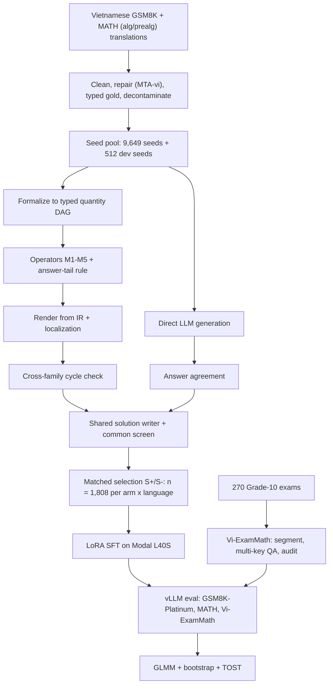

# Vi-Math-SMT

> Symbolic vs. directly generated training data for Vietnamese mathematical
> reasoning: a typed quantity-graph augmentation pipeline, a controlled
> comparison with verification and an English mirror, and the Vi-ExamMath
> benchmark of Vietnamese Grade-10 entrance exams.

[](https://www.python.org/)
[](LICENSE)
[](#project-status)

Small language models need Vietnamese math data, and the two main ways to
synthesize it compete: **symbolic** augmentation (formalize a problem as a
program, mutate the program, recompute the answer exactly, re-express it in
text) and **direct generation** by a large language model. This repository
contains the full pipeline we use to build both kinds of data under a
controlled design, the Vi-ExamMath benchmark, training and evaluation code,
the statistical analysis, and all reports.

## Highlights

- **Typed quantity DAG.** Each seed problem becomes a graph of typed quantities
  (*Count, Money, Measure, Rate, Percent, Ratio, Age, Time*) with exact rational
  values; type propagation rules out invalid intermediates such as "0.5 candies".
- **Five constrained operators** (value resampling, inversion, step insertion,
  relation change, query shift) with plausible value ranges, story-role checks
  and an **answer-tail rule** that rejects mutations which only bolt arithmetic
  onto the old answer.
- **Rendering from the IR** with plausibility-aware localization (Vietnamese
  names, đồng amounts, units), followed by a blind **cross-family cycle check**.
- **Controlled comparison.** Symbolic (`Y`) vs. direct generation (`N`), each
  with and without verification (`±`), sharing one solution writer, one quality
  screen, one seed set and one data size, in Vietnamese and an English mirror.
- **Vi-ExamMath.** 1,545 items from 270 exams (58 provinces, 2017–2026); 1,367
  with verified keys; audited label-error rate 1.3% [0.16, 4.7].
- **Pre-registered statistics.** Binomial GLMM (lme4) with crossed item × run
  effects, two-way cluster bootstrap, Holm, TOST equivalence and BH.

## Results

Qwen3-0.6B-Base, LoRA r = 32, n = 1,808 training items per arm, 4 training
seeds (Vietnamese). Accuracy in %: pass@1 over 4 samples for GSM8K-Platinum and
MATH; greedy for Vi-ExamMath. Mean (SD across seeds).

| Arm | GSM8K-Platinum (VI) | MATH alg/prealg (VI) | Vi-ExamMath |
|---|---:|---:|---:|
| S0 (original seeds) | 38.6 (0.5) | 26.3 (1.7) | 24.2 (1.9) |
| Y+ symbolic, verified | 45.1 (0.5) | 36.4 (1.7) | 30.3 (1.3) |
| Y− symbolic, unverified | 44.7 (1.1) | 36.9 (0.8) | 30.8 (0.9) |
| N+ direct, verified | **48.1** (1.0) | **37.5** (1.1) | 30.5 (0.5) |
| N− direct, unverified | 46.6 (0.6) | 37.3 (1.0) | **30.9** (1.4) |

- Every generated-data arm beats S0 on every set (+6.1 to +9.5 on GSM8K-Platinum,
  +10.2 to +11.2 on MATH, +6.1 to +6.7 on Vi-ExamMath; q < 0.001).
- On Vi-ExamMath, symbolic vs. direct (H2) and verified vs. unverified (H3) are
  **equivalent within ±3 points** (TOST; MDE80 2.3 points).
- The symbolic certificate secures the answer (98% faithful after the cycle
  check) but not the text: 12% of Y+ items are judged absurd vs. 5% for N+.
- Language × verification (H1) is provisional (one English training seed);
  the certifiable-item contrast (H4) is underpowered.

Full results, decision rules and caveats are reported in the accompanying paper.

## Pipeline



| Stage | What it does | Module |
|---|---|---|
| Seeds | clean, repair translations, typed gold, decontaminate, split dev | `vi_math_verified_aug/seeds/` |
| Benchmark | crawl, segment, multi-key answer QA, audit → `core_v1.1` | `vi_exam/`, `vi_exam_qa/` |
| Eval sets | frozen VI/EN primary sets (GSM8K-Platinum + MATH) | `eval_sets/` |
| Grader | typed, locale-aware answer checking | `eval/math_verify.py` |
| Symbolic library | typed IR, operators, answer-tail rule | `symbolic/` |
| Arm Y | formalize, mutate, render, cycle check, export (VI + EN from one IR) | `arm_y/` |
| Arm N | direct generation, shared solution writer, common screen | `scale_gen/` |
| Selection | matched S+/S− sets, strata, diversity | `analysis/select_v1.py` |
| Training | LoRA SFT, GRPO, fail-fast guards, launcher | `train/`, `evalrun/` |
| Analysis | GLMM export, bootstrap, Holm/BH/TOST, error attribution, gate audit | `analysis/` |

Stages run as `python -m vi_math_verified_aug.<package>.<module>` (e.g. `seeds.build`, `arm_y.pipeline`, `scale_gen.run`, `train.launcher`, `analysis.c3_r1_results`).

## Repository Layout

```text
vi-math-smt/
├── vi_math_verified_aug/      # the pipeline (see the table above)
│   ├── common/                # LLM client, batching, API ledger, rate limits, prompt registry
│   ├── seeds/  symbolic/  arm_y/  scale_gen/
│   ├── vi_exam/  vi_exam_qa/  eval/  eval_sets/
│   ├── train/  evalrun/  analysis/  qa/  infra/
├── prompts/                   # versioned prompts
├── tests/                     # unit tests
├── jobs/                      # kernel specs, launcher queue, run manifests and metrics
├── bench/                     # throughput and GPU benchmarks
├── src/, notebooks/           # SMT-LIB formalization and translation utilities (not used by the pipeline above)
└── data/                      # git-ignored; delivered as a separate bundle
```

## Quick Start

```bash
git clone https://github.com/datdaide1/vi-math-smt.git
cd vi-math-smt
uv sync                      # or: pip install -r requirements.lock.txt
cp .env.example .env         # fill in the API keys you need
python -m pytest tests -q    # light unit tests
```

Pinned environments: `uv.lock` (local) and `requirements.lock.txt`.

## Data and Artifacts

Datasets, evaluation predictions and the 25 trained LoRA adapters are not stored
in Git; they are distributed separately as a data bundle with a SHA-256 manifest,
with a datasheet per dataset and a model card per adapter.

The generated training sets were written by LLMs (generator, renderer, solution
writer and screen); the model ids, prompt versions and call logs for every
stage are recorded in the datasheets.

## Dataset Sources and Licensing

| Source | Use | License |
|---|---|---|
| GSM8K (Cobbe et al., 2021) | seeds (train), evaluation via GSM8K-Platinum | MIT |
| MATH (Hendrycks et al., 2021) | seeds (algebra, prealgebra train), evaluation | MIT |
| GSM8K-Platinum (Vendrow et al., 2025) | evaluation | see upstream |
| Vietnamese Grade-10 entrance exams | Vi-ExamMath | public exam papers; see the datasheet |

Details and citations: [`DATA_SOURCES.md`](DATA_SOURCES.md).

## Reproducibility

- All evaluation runs use vLLM in batch-invariant mode; repeated runs of the
  same adapter give identical outputs.
- All arms of a (model size, language, seed) cell are trained on the same GPU
  type and precision.
- Every training run records its git commit, data SHA-256 and config hash in
  its manifest.
- The analysis design (hypotheses, decision rule, equivalence margin) was fixed
  before arm results were seen.

## Project Status

Research code. The 0.6B tranche (Vietnamese seeds 0–3, English seed 0) is
complete. Planned next steps: more English training seeds, 4-shot evaluation of the
adapters, length-matched training sets, 1.7B and a second model family, and an
RLVR stage.

## License

Source code and documentation are released under the [MIT License](LICENSE),
unless a file states otherwise. The license does not override the terms of
third-party datasets or model weights; see [`DATA_SOURCES.md`](DATA_SOURCES.md).

## Citation

```bibtex
@misc{tran2026vimath,
  title  = {Symbolic or Directly Generated Data for Vietnamese Math Reasoning?
            Typed Quantity Graphs, Controlled Verification, and a Vietnamese Exam Benchmark},
  author = {Tran, Hoang Dat and Ha, My Linh},
  year   = {2026},
  note   = {VNU University of Science, Vietnam National University, Hanoi}
}
```

## Acknowledgements

This work builds on GSM8K, MATH, GSM8K-Platinum, Qwen3, LoRA, Unsloth, vLLM,
bge-m3, SymPy, lme4 and the broader open-source mathematical reasoning ecosystem.
